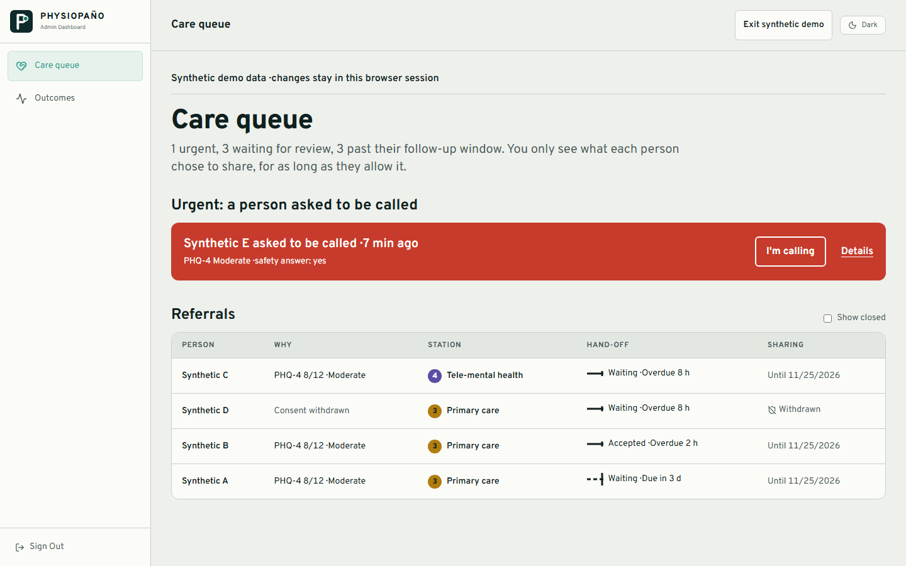

# PHYSIOPAÑO

PHYSIOPAÑO is a wearable and companion app that help a person notice sustained changes from their own resting baseline and decide whether to seek support. The hackathon prototype combines an ESP32 wristband, an Android app with short well-being check-ins, and a web console for care navigators. The wearer chooses what to share and can withdraw access.

## Run the synthetic navigator demo

With Node.js and npm installed, run these commands from a clone of this repo.

~~~sh
cd admin-web-react
npm ci
npm run dev
~~~

Open [the local demo](http://localhost:5173/#/demo). Try accepting a referral, reviewing a withdrawn referral, and switching to **Outcomes**. The demo needs no account or Firebase project. All cases are synthetic, and changes stay in the browser session.

## Source and setup

| Component | What it contains |
| --- | --- |
| [Android app](Mobile%20App/stress_monitor_app/) | Flutter app for BLE readings, personal baselines, check-ins, and consent. See the [mobile setup](Mobile%20App/stress_monitor_app/README.md). |
| [ESP32 firmware](Firmware/Final_Code/) | Arduino sketch for pulse, skin conductance, skin temperature, and motion sensing. Build with the ESP32 board package and SparkFun MAX3010x library. |
| [Navigator console](admin-web-react/) | React prototype with a synthetic care queue and outcomes dashboard. For live development, copy the [.env example](admin-web-react/.env.example) to .env.local and fill it in from a separate test Firebase project. Navigator access requires the navigator custom claim. |
| [Firebase rules](firestore.rules) and [outcomes reporting](functions/) | Consent-protected referral storage and aggregate reporting. |

The wristband and app are prototype components. Clinical routing thresholds and live end-to-end delivery still need validation.

[View the app with synthetic baseline history](docs/images/synthetic-mobile-baseline.png).
